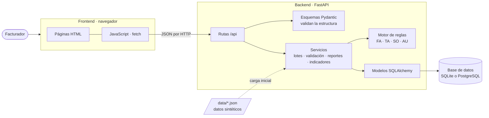
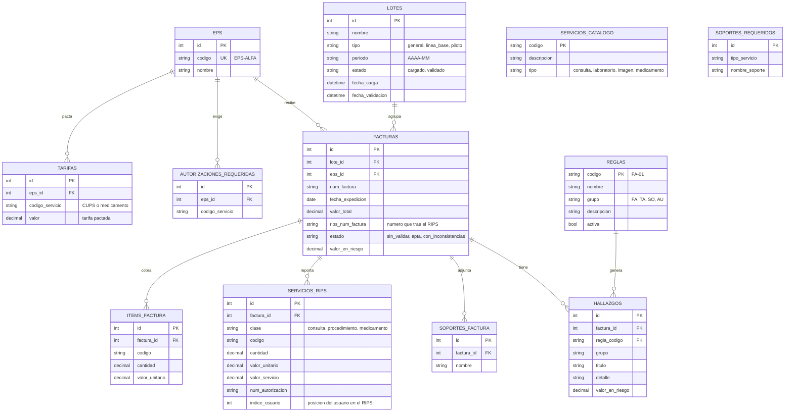
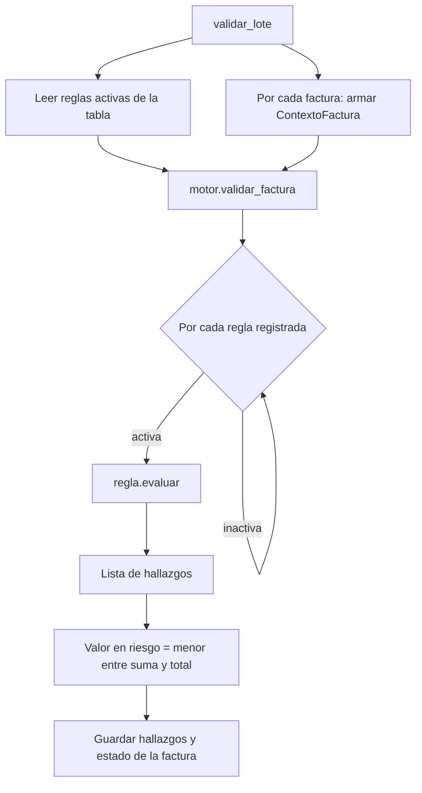

# Arquitectura de AuditaGlosas HUEM

Documento de diseño (hito **H3**). Explica cómo está organizado el sistema, qué hace cada parte y por qué se
tomó cada decisión, en lenguaje sencillo para que cualquier integrante del equipo lo pueda sustentar.

## 1. Idea general

El facturador sube un **lote de facturas** (cada una con su RIPS en JSON). El sistema guarda el lote, le aplica un
**catálogo de reglas** y devuelve, para cada factura, si está **apta para radicar** o qué **hallazgos** tiene, con el
**valor en riesgo de glosa**. Con esos resultados se arman reportes e indicadores.

El sistema tiene tres capas, cada una con una sola responsabilidad:

| Capa | Qué hace | Tecnología |
|---|---|---|
| Frontend | Lo que ve el facturador: páginas, tarjetas, gráficas | HTML + CSS + JavaScript (sin frameworks) |
| Backend | Recibe las peticiones, aplica las reglas, arma los reportes | Python + FastAPI |
| Base de datos | Guarda lotes, facturas, hallazgos, reglas y contratos | SQLite (desarrollo) o PostgreSQL (producción), con SQLAlchemy |

## 2. Estructura de carpetas

```
AuditaGlosas-HUEM/
├── index.html                  Prototipo del Sprint 0 (demo en GitHub Pages; no se modifica)
├── data/                       Datos sintéticos de prueba
│   ├── contratos_tarifas.json      Tarifas pactadas y autorizaciones de 3 EPS
│   ├── catalogo_servicios.json     Descripción y tipo de cada servicio; soportes obligatorios por tipo
│   ├── lote_demo.json              12 facturas con su RIPS
│   ├── lote_linea_base_200.json    200 facturas generadas, 40 % con errores sembrados
│   ├── lote_piloto_200.json        200 facturas generadas, 15 % con errores sembrados
│   └── *_esperado.json             Qué reglas debe disparar cada factura generada
├── docs/                       Documentación (plan, bitácora, arquitectura, manual)
├── frontend/                   Páginas web que sirve FastAPI
│   ├── *.html                      Una página por pantalla
│   ├── css/estilos.css             Un solo archivo de estilos
│   └── js/                         comun.js (funciones compartidas) + un archivo por página
└── backend/
    ├── main.py                 Punto de entrada: `uvicorn main:app`
    ├── requirements.txt        Librerías necesarias
    ├── app/
    │   ├── principal.py            Crea la aplicación y conecta todas las piezas
    │   ├── configuracion.py        Rutas de carpetas y variable DATABASE_URL
    │   ├── base_datos.py           Conexión a la base de datos y sesiones
    │   ├── modelos.py              Las tablas (una clase por tabla)
    │   ├── esquemas.py             Forma de los datos que entran y salen por la API
    │   ├── reglas/                 MOTOR DE REGLAS (no conoce la base de datos)
    │   │   ├── base.py                 Clase base de una regla, contexto y hallazgo
    │   │   ├── registro.py             Lista de reglas disponibles
    │   │   ├── facturacion.py          FA-01, FA-02, FA-03, FA-04
    │   │   ├── tarifas.py              TA-01, TA-02
    │   │   ├── soportes.py             SO-01
    │   │   ├── autorizaciones.py       AU-01
    │   │   └── motor.py                Aplica las reglas activas a una factura
    │   ├── servicios/              LÓGICA DE NEGOCIO (une el motor con la base de datos)
    │   │   ├── lotes.py                Guardar un lote
    │   │   ├── carga_inicial.py        Cargar contratos, catálogo y lote demo
    │   │   ├── validacion.py           Validar un lote y guardar los hallazgos
    │   │   ├── catalogo_reglas.py      Activar y desactivar reglas
    │   │   ├── reportes.py             Reportes por causal, por EPS y CSV
    │   │   ├── indicadores.py          Porcentaje de facturas glosadas
    │   │   └── estadistica.py          Prueba z de diferencia de proporciones
    │   └── rutas/                  ENDPOINTS de la API (uno por tema)
    ├── scripts/                Utilidades de consola (carga inicial, generador de lotes)
    └── tests/                  Pruebas automáticas con pytest
```

**Regla de dependencias:** las flechas van en un solo sentido. Las `rutas` llaman a los `servicios`; los
`servicios` usan los `modelos` y el motor de `reglas`; el motor de `reglas` no llama a nadie. Así cada parte se puede
probar por separado.

## 3. Diagrama de componentes



**Recorrido de una validación:**

1. El facturador elige un archivo JSON en la página *Cargar lote*.
2. La ruta `POST /api/lotes` recibe el JSON. Los **esquemas** revisan que tenga la estructura correcta; si no, se
   responde con la lista de errores en español.
3. El servicio de **lotes** guarda el lote, sus facturas, ítems, servicios del RIPS y soportes.
4. Con `POST /api/lotes/{id}/validar`, el servicio de **validación** arma un *contexto* por cada factura
   (factura + contrato de su EPS + catálogo) y se lo entrega al **motor**.
5. El motor ejecuta cada regla **activa** y devuelve los hallazgos. El servicio los guarda y marca la factura como
   *apta* o *con inconsistencias*.
6. Las páginas de resultados y reportes consultan lo guardado.

## 4. Modelo entidad-relación



**Notas del modelo**

- **No hay tabla de pacientes.** El RIPS trae el documento del usuario, pero el sistema lo **descarta al cargar**
  (Ley 1581 de 2012). Solo se guarda `indice_usuario`: "este servicio es del primer usuario del RIPS".
- **Servicios del RIPS en una sola tabla.** Consultas, procedimientos y medicamentos comparten casi todas las
  columnas; la columna `clase` dice cuál es. Así las reglas recorren una sola lista.
- `SERVICIOS_CATALOGO` y `SOPORTES_REQUERIDOS` no tienen llaves foráneas a propósito: una factura puede traer un
  código que no existe en el catálogo, y eso no debe impedir cargarla (lo debe detectar una regla).
- Una misma factura puede estar en dos lotes distintos (por ejemplo, antes y después de corregirla), pero no dos
  veces en el mismo lote.
- El dinero se guarda con dos decimales (`Numeric(14,2)`).

## 5. Diseño del motor de reglas

### 5.1 Cada regla es una clase

Todas las reglas heredan de `ReglaBase` y tienen los mismos cuatro datos y un método:

```python
@registrar
class ReglaSoporteObligatorio(ReglaBase):
    codigo = "SO-01"
    nombre = "Soporte obligatorio faltante"
    grupo = "SO"                      # grupo de causal de la Res. 2284 de 2023
    descripcion = "La factura incluye los soportes obligatorios según el tipo de servicio."

    def evaluar(self, contexto):      # devuelve una lista de hallazgos (vacía si todo está bien)
        ...
```

### 5.2 El contexto

Una regla **no consulta la base de datos**. Recibe un `ContextoFactura` con todo lo que necesita ya listo:

| Dato del contexto | De dónde sale |
|---|---|
| Número, valor total, ítems y soportes de la factura | Tablas `facturas`, `items_factura`, `soportes_factura` |
| Número de factura que trae el RIPS y servicios prestados | `facturas.rips_num_factura`, `servicios_rips` |
| Tarifas pactadas y códigos que exigen autorización | `tarifas`, `autorizaciones_requeridas` de la EPS de la factura |
| Descripción y tipo de cada servicio, soportes por tipo | `servicios_catalogo`, `soportes_requeridos` |

Ventaja: para probar una regla basta con armar un contexto a mano; no hace falta base de datos.

### 5.3 El hallazgo y el valor en riesgo

Cada regla devuelve hallazgos con: código de la regla, grupo, título, detalle en español y **valor en riesgo**.

| Regla | Grupo | Cuándo genera hallazgo | Valor en riesgo |
|---|---|---|---|
| FA-01 | Facturación | El número de factura del RIPS es distinto al de la factura | Valor total de la factura (causa devolución) |
| FA-02 | Facturación | El total de la factura no es igual a la suma de servicios del RIPS | La diferencia |
| FA-03 | Facturación | Un código está en la factura y no en el RIPS, o al revés | Valor del ítem o del servicio |
| FA-04 | Facturación | Una consulta o procedimiento no tiene código de 6 caracteres válidos | Valor del servicio |
| TA-01 | Tarifas | El valor unitario es distinto a la tarifa pactada | Diferencia × cantidad |
| TA-02 | Tarifas | El servicio no tiene tarifa pactada con la EPS | Valor del servicio |
| SO-01 | Soportes | Falta un soporte obligatorio para el tipo de servicio | Valor del servicio |
| AU-01 | Autorizaciones | La EPS exige autorización y el servicio no la trae | Valor del servicio |

El **valor en riesgo de la factura** es la suma de sus hallazgos, pero nunca mayor al valor total de la factura
(no se puede glosar más de lo facturado). Las comparaciones de dinero aceptan una diferencia de hasta $0,50 por
redondeos.

### 5.4 El registro

`registro.py` guarda un diccionario `codigo → regla`. El decorador `@registrar` mete la regla ahí cuando Python
carga el archivo. **Para agregar una regla nueva** basta con:

1. Escribir una clase nueva que herede de `ReglaBase` y ponerle `@registrar`.
2. Reiniciar el servidor: al arrancar, `sincronizar_reglas()` la crea en la tabla `reglas` como activa.

No hay que tocar el motor ni la API.

### 5.5 Activar y desactivar

La tabla `reglas` tiene la columna `activa`. Antes de validar un lote, el servicio lee qué códigos están activos y
se los pasa al motor; el motor salta las demás. Como cada validación borra los hallazgos anteriores del lote y los
vuelve a calcular, basta desactivar una regla y **validar de nuevo** para ver el efecto.



## 6. Endpoints de la API

Todos empiezan por `/api`. La documentación interactiva se genera sola en **`/docs`**.

| Método | Ruta | Qué hace | Historia |
|---|---|---|---|
| GET | `/api/salud` | Confirma que el servidor está vivo | — |
| POST | `/api/lotes` | Carga un lote en JSON (valida la estructura) | HU-01 |
| GET | `/api/lotes` | Lista los lotes cargados | HU-01 |
| GET | `/api/lotes/{id}` | Datos de un lote | HU-01 |
| DELETE | `/api/lotes/{id}` | Elimina un lote con sus facturas y hallazgos | HU-01 |
| POST | `/api/lotes/{id}/validar` | Aplica las reglas activas al lote | HU-02, 03, 04 |
| GET | `/api/lotes/{id}/resultados` | Resumen del lote y estado de cada factura | HU-05 |
| GET | `/api/facturas/{id}` | Detalle de una factura con sus hallazgos | HU-05 |
| GET | `/api/reportes/por-causal` | Hallazgos y valor en riesgo por grupo de causal y por regla | HU-05 |
| GET | `/api/reportes/por-eps` | Facturas, inconsistencias y valor en riesgo por EPS | HU-05 |
| GET | `/api/reportes/exportar.csv` | Descarga el reporte de hallazgos en CSV | HU-05 |
| GET | `/api/reglas` | Catálogo de reglas | HU-06 |
| POST | `/api/reglas/{codigo}/activar` | Activa una regla | HU-06 |
| POST | `/api/reglas/{codigo}/desactivar` | Desactiva una regla | HU-06 |
| GET, POST | `/api/eps` | Lista o crea EPS | HU-04 |
| GET, PUT, DELETE | `/api/eps/{codigo}` | Consulta, edita o elimina una EPS | HU-04 |
| GET, POST | `/api/eps/{codigo}/tarifas` | Lista o crea tarifas pactadas | HU-04 |
| PUT, DELETE | `/api/eps/{codigo}/tarifas/{codigo_servicio}` | Edita o elimina una tarifa | HU-04 |
| GET, POST | `/api/eps/{codigo}/autorizaciones` | Lista o agrega servicios que exigen autorización | HU-02 |
| DELETE | `/api/eps/{codigo}/autorizaciones/{codigo_servicio}` | Quita la exigencia de autorización | HU-02 |
| GET | `/api/catalogo` | Catálogo de servicios y soportes obligatorios por tipo | HU-02 |
| PUT, DELETE | `/api/catalogo/servicios/{codigo_servicio}` | Crea, actualiza o quita un servicio del catálogo | HU-02 |
| GET | `/api/indicadores` | Indicadores generales para la página de inicio | HU-05 |
| GET | `/api/indicadores/glosas` | Porcentaje de facturas glosadas por periodo y por causal | HU-07 |
| POST | `/api/indicadores/prueba-z` | Prueba z de diferencia de proporciones (línea base vs. piloto) | HU-07 |

Los reportes aceptan filtros opcionales por lote (`lote_id`), por periodo (`periodo=AAAA-MM`) y por tipo de lote
(`tipo=general|linea_base|piloto`).

**Forma de los errores.** Todos responden `{"detail": "mensaje"}`. Cuando hay varios problemas (por ejemplo, un
lote mal formado) se agrega la lista `errores`, con un mensaje por problema y la ubicación exacta:
`Factura n.º 4 (FV-1004) → valorTotal: falta este campo obligatorio.`

## 7. Decisiones de diseño y por qué

| Decisión | Motivo |
|---|---|
| Reglas como clases independientes con registro | Cumple HU-06: agregar o apagar una regla sin tocar el resto |
| El motor no conoce la base de datos | Se prueba con datos armados a mano; las pruebas son rápidas y claras |
| SQLAlchemy con `DATABASE_URL` | El mismo código corre en SQLite (desarrollo) y PostgreSQL (producción) |
| No guardar el documento del paciente | Ley 1581 de 2012: el sistema no necesita identificar al paciente para validar |
| Frontend sin frameworks ni librerías externas | Funciona sin internet en el hospital y el equipo puede explicar cada línea |
| Errores de estructura vs. hallazgos | Un archivo mal formado se **rechaza** al cargar; una factura con un dato incorrecto se **carga** y la regla lo reporta |
| Revalidar borra y recalcula los hallazgos | El resultado siempre corresponde a las reglas activas en ese momento |

## 8. Frontend

Cada pantalla es un archivo HTML casi vacío más un archivo JavaScript que pide los datos a la API y dibuja la
página. FastAPI sirve las páginas (`rutas/paginas.py`) y los archivos de `frontend/` bajo `/static`.

| Dirección | Archivos | Qué muestra | Historia |
|---|---|---|---|
| `/` | `index.html`, `js/inicio.js` | Indicadores generales y últimos lotes | HU-05 |
| `/carga` | `carga.html`, `js/carga.js` | Subir un lote y lista de lotes | HU-01 |
| `/resultados` | `resultados.html`, `js/resultados.js` | Tarjetas, gráficas y facturas de un lote | HU-05 |
| `/factura` | `factura.html`, `js/factura.js` | Hallazgos de una factura, factura contra RIPS | HU-05 |
| `/reportes` | `reportes.html`, `js/reportes.js` | Por causal y por EPS; exportar CSV | HU-05 |
| `/linea-base` | `linea-base.html`, `js/linea-base.js` | Indicador de glosas y prueba z | HU-07 |
| `/reglas` | `reglas.html`, `js/reglas.js` | Interruptores de las reglas | HU-06 |
| `/contratos` | `contratos.html`, `js/contratos.js` | EPS, tarifas, autorizaciones y catálogo | HU-02, HU-04 |

Archivos compartidos: `js/comun.js` (llamadas a la API, creación de elementos, formatos, menú, avisos),
`js/graficas.js` (barras, barra segmentada y columnas hechas con HTML, CSS y SVG), `js/lotes.js` (tabla de lotes) y
`css/estilos.css`.

**Gráficas.** No se usa ninguna librería. El verde azulado de «aptas» y el rojo de «con inconsistencias» se
eligieron para que también los distingan las personas con daltonismo, y nunca van solos: cada gráfica lleva las
cifras escritas, una leyenda y una tabla con los mismos datos.

## 9. Seguridad y protección de datos

| Riesgo | Cómo se atiende | Dónde |
|---|---|---|
| Guardar datos de pacientes (Ley 1581 de 2012) | Los esquemas de entrada descartan todo campo que no usan (`extra="ignore"`); del usuario del RIPS solo queda su posición. Una prueba recorre toda la base buscando documentos | `esquemas.py`, `test_base_datos.py`, `test_generador.py` |
| Devolver datos sensibles en un error | Los mensajes de error dicen la ubicación y el problema, nunca repiten el valor recibido | `errores.py` |
| Código malicioso dentro de un lote (XSS) | El frontend nunca usa `innerHTML`: todo dato se escribe como texto con la función `h()`. Además el servidor envía una política de contenido (CSP) que solo permite scripts y estilos propios | `js/comun.js`, `principal.py`, `test_paginas.py` |
| Fórmulas maliciosas al abrir el CSV en Excel | Las celdas que empiezan por `=`, `+`, `-` o `@` se exportan con un apóstrofo delante | `servicios/reportes.py` |
| Inyección SQL | Todas las consultas pasan por SQLAlchemy con parámetros; no se arma SQL con texto | `servicios/` |
| Archivos enormes | Máximo 20 MB por petición y 5.000 facturas por lote | `principal.py`, `esquemas.py` |
| Que otra página incruste el sistema | Cabeceras `X-Frame-Options: DENY` y `frame-ancestors 'none'` | `principal.py` |

Lo que **no** tiene esta versión: inicio de sesión, roles ni cifrado propio (HTTPS lo pone el servidor donde se
instale). Por eso debe usarse solo en la red interna y con datos sintéticos hasta que eso exista.

## 10. Indicador de glosas y prueba z (HU-07)

**Indicador.** `% de facturas glosadas = facturas con inconsistencias ÷ facturas validadas × 100`. Se calcula en
total, por periodo (mes del lote) y por causal (`servicios/indicadores.py`). Las facturas sin validar no cuentan.

**Línea base y piloto.** Al cargar un lote se le pone un tipo: `general`, `linea_base` o `piloto`. La línea base es
el «antes» y el piloto el «después».

**Prueba z de diferencia de proporciones** (`servicios/estadistica.py`). Responde si la baja en el porcentaje de
glosas es real o pudo ser casualidad:

```
p1 = x1 / n1        proporción glosada en la línea base
p2 = x2 / n2        proporción glosada en el piloto
p  = (x1 + x2) / (n1 + n2)                  proporción combinada
EE = raíz( p · (1 − p) · (1/n1 + 1/n2) )    error estándar
z  = (p1 − p2) / EE
```

- **H0:** las dos proporciones son iguales. **H1:** la del piloto es menor (una cola; es la del proyecto) o
  simplemente distinta (dos colas).
- El **valor p** es la probabilidad de ver una diferencia así de grande si H0 fuera cierta. Si es menor que
  **alfa = 0,05**, se rechaza H0: la reducción es estadísticamente significativa.
- Se usa solo la biblioteca estándar de Python (`math.erfc` para el valor p y `statistics.NormalDist` para el valor
  crítico), sin librerías externas.
- El servicio también devuelve el intervalo de confianza de la diferencia, avisa cuando las muestras son muy
  pequeñas para la aproximación normal y redacta la interpretación en español.
- Las cifras salen de los lotes marcados como línea base y piloto, o se digitan (solo totales, nunca datos de
  pacientes) cuando se tengan las cifras reales del hospital.

Ejemplo comprobado a mano en las pruebas: 45 glosadas de 100 contra 30 de 100 → p = 0,375; EE = 0,0685;
z = 2,19; valor p = 0,014 → se rechaza H0.

## 11. Generador de lotes sintéticos

`backend/scripts/generar_lote.py` inventa facturas correctas a partir de los contratos y del catálogo, y a un
porcentaje de ellas les **siembra un error conocido** (a veces dos). Cada error está pensado para disparar una sola
regla:

| Regla | Error que se siembra |
|---|---|
| FA-01 | El RIPS trae el número de otra factura |
| FA-02 | Al total de la factura se le suma un valor |
| FA-03 | En la factura se cambia el último dígito de un código |
| FA-04 | Un código queda con 5 caracteres |
| TA-01 | Se cobra por encima de la tarifa pactada |
| TA-02 | Se agrega un servicio que la EPS no tiene pactado |
| SO-01 | Se quitan los soportes |
| AU-01 | Se borra el número de autorización |

Junto al lote se guarda un archivo `_esperado.json` con las reglas que debe disparar cada factura. Las pruebas
cargan el lote, lo validan y comparan: el motor debe encontrar **exactamente** eso, ni más ni menos. Como usa una
semilla fija, el mismo comando siempre produce el mismo lote.

## 12. Pruebas

Las pruebas están en `backend/tests/` y se ejecutan con `python -m pytest`. Usan una base de datos SQLite en
memoria que se crea vacía para cada prueba.

| Nivel | Qué se prueba | Cómo |
|---|---|---|
| Regla | Cada regla con casos que pasan, casos que fallan y bordes (tolerancia, vacíos) | Se arma un `ContextoFactura` a mano; no hay base de datos |
| Motor | Orden de las reglas, reglas apagadas, tope del valor en riesgo | Igual, con contextos a mano |
| Servicios | Guardar, validar, revalidar, reportes, indicadores | Base en memoria con la carga inicial |
| API | Cada endpoint, con respuestas correctas y errores | Cliente de pruebas de FastAPI |
| Integral | Lote demo: 12 facturas, 5 aptas, 7 con inconsistencias, $260.000 | Por el motor, por los servicios y por la API |
| Generador | El motor detecta exactamente los errores sembrados | 5 semillas de 300 facturas y los dos lotes de `data/` |
| Frontend | Las páginas responden, enlazan archivos que existen y cumplen la política de seguridad | Revisión del HTML y del JavaScript |

## 13. Limitaciones conocidas y trabajo futuro

- Del RIPS se leen **consultas, procedimientos y medicamentos**. Urgencias, hospitalización, recién nacidos y otros
  servicios (Res. 2275 de 2023) quedan para una siguiente versión.
- No hay inicio de sesión ni roles todavía.
- Las tablas se crean automáticamente al arrancar. Cuando el modelo cambie con datos reales en producción convendrá
  usar migraciones (Alembic).
- "Factura glosada" se mide como *factura con inconsistencias detectadas por el sistema*, porque aún no se reciben
  las respuestas reales de las EPS.
