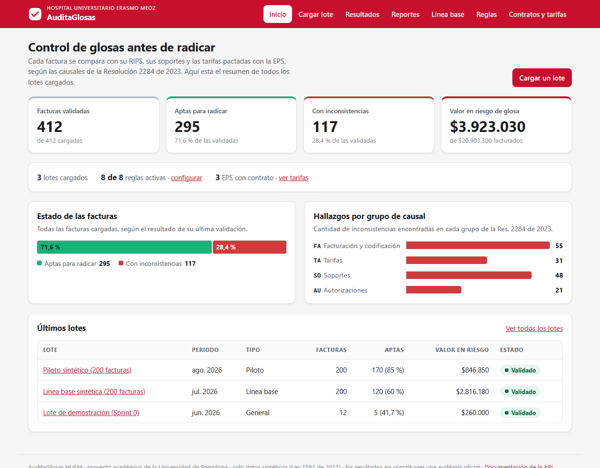
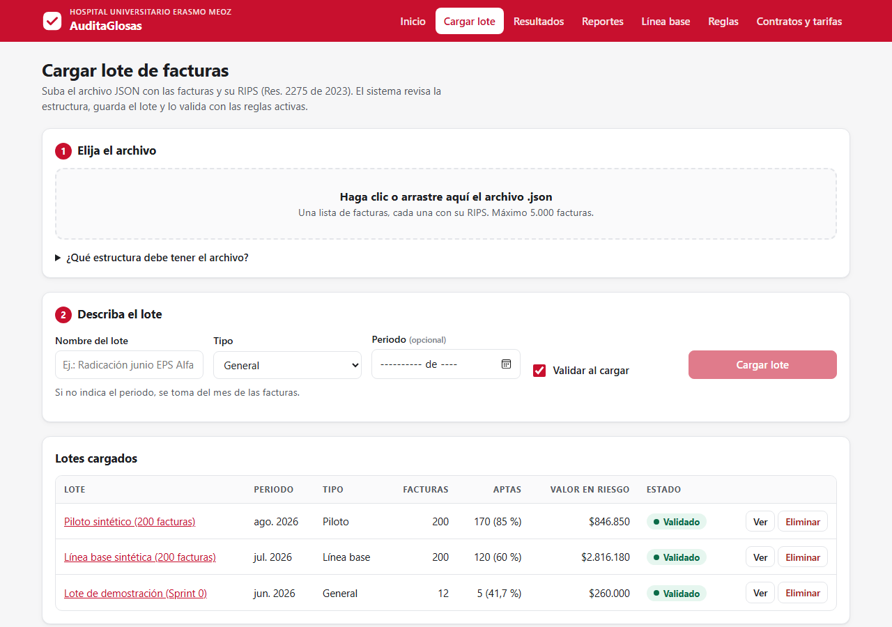
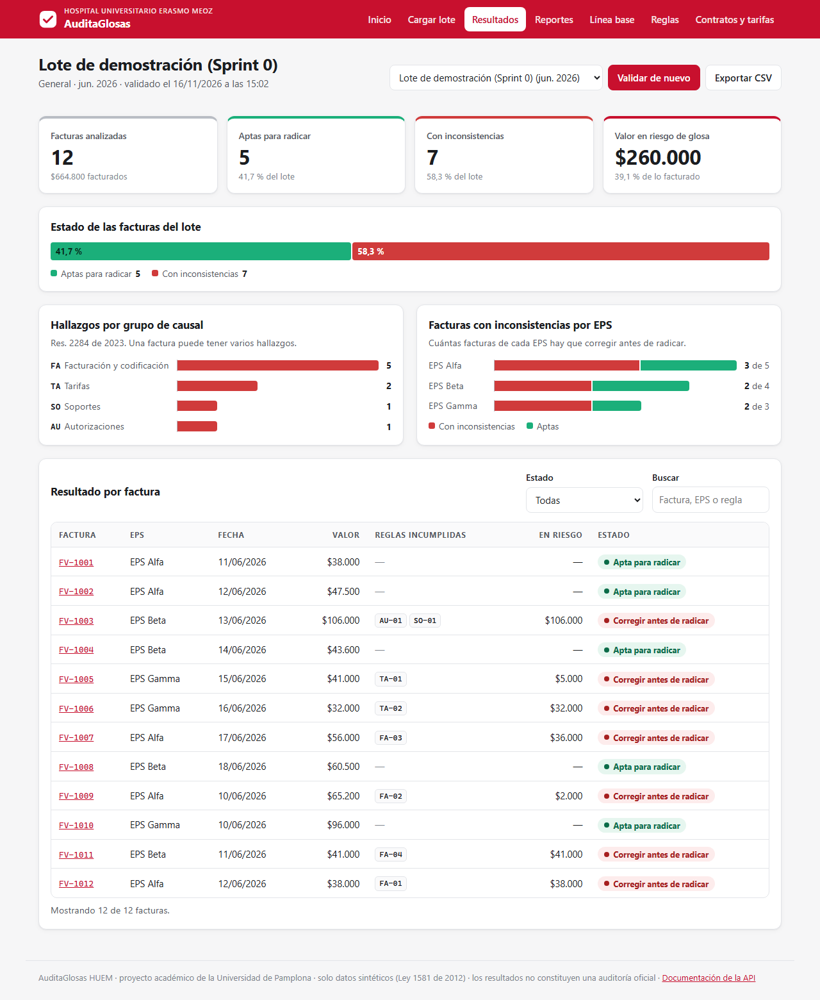
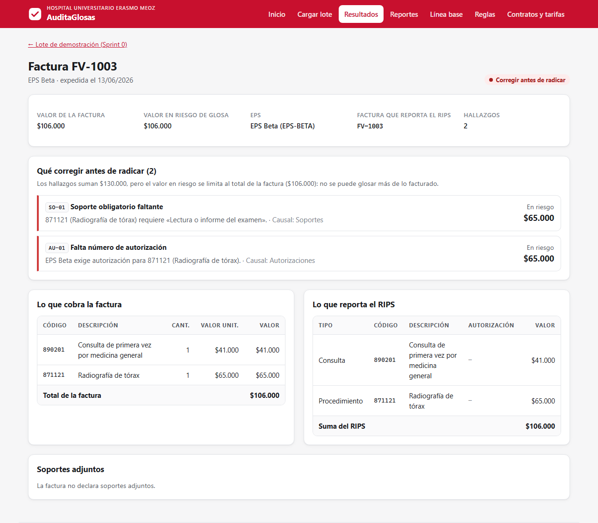
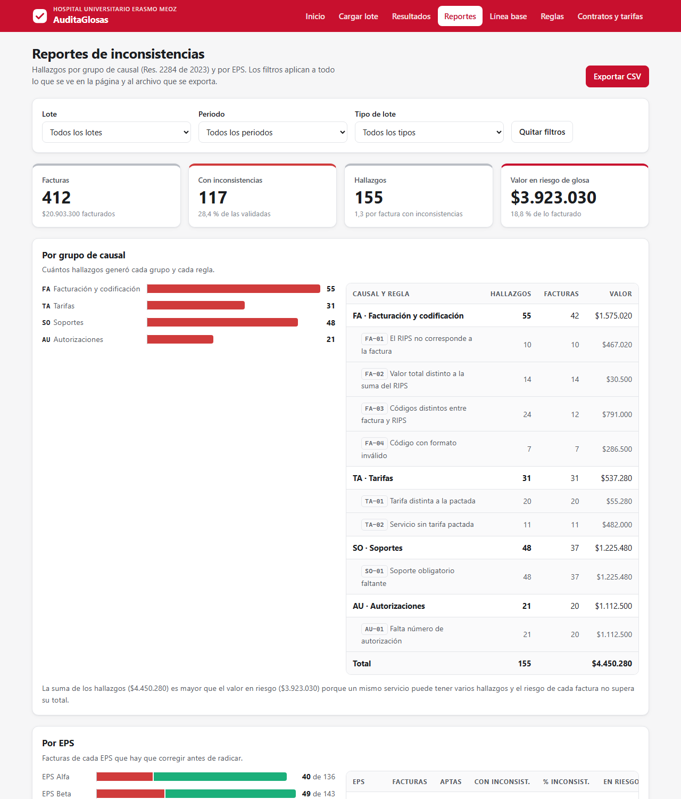
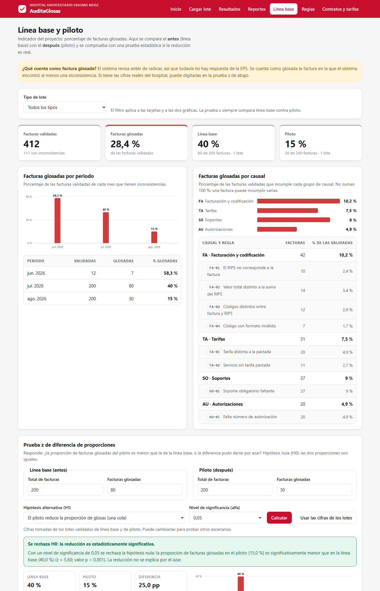
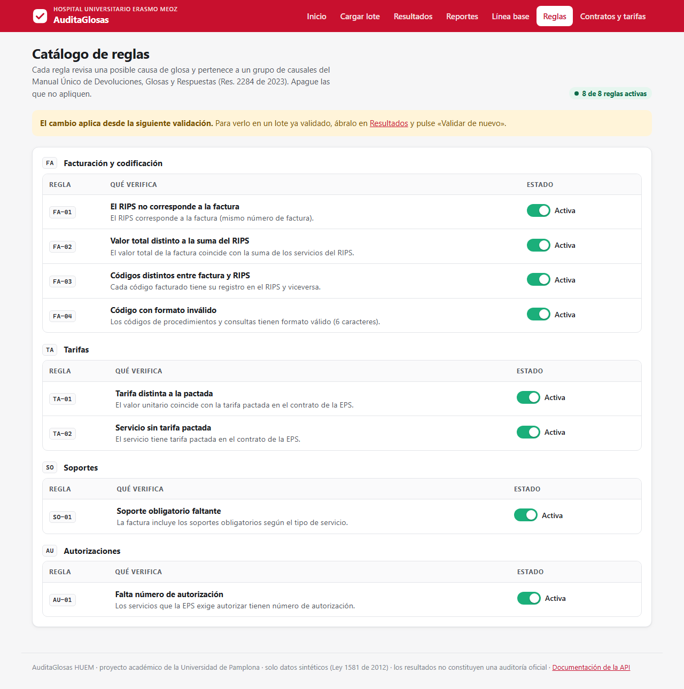
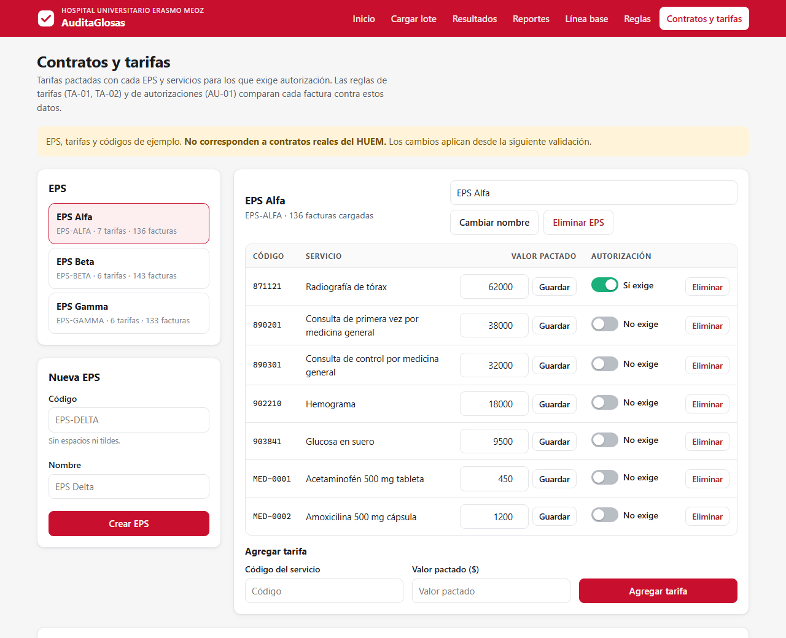

# Manual de usuario · AuditaGlosas HUEM

Este manual es para quien **prepara y radica las facturas**. Explica, paso a paso y sin términos técnicos, cómo
revisar un lote antes de enviarlo a la EPS.

> **Importante.** El sistema es una ayuda para encontrar errores antes de radicar. No reemplaza la auditoría oficial
> de cuentas médicas. En esta versión solo se usan **datos de prueba** (sintéticos).

## Contenido

1. [Para qué sirve](#1-para-qué-sirve)
2. [Entrar al sistema](#2-entrar-al-sistema)
3. [Pantalla de inicio](#3-pantalla-de-inicio)
4. [Cargar un lote de facturas](#4-cargar-un-lote-de-facturas)
5. [Validar y leer los resultados](#5-validar-y-leer-los-resultados)
6. [Ver qué corregir en una factura](#6-ver-qué-corregir-en-una-factura)
7. [Reportes y exportación a Excel](#7-reportes-y-exportación-a-excel)
8. [Línea base y piloto](#8-línea-base-y-piloto)
9. [Catálogo de reglas](#9-catálogo-de-reglas)
10. [Contratos y tarifas](#10-contratos-y-tarifas)
11. [Mensajes de error frecuentes](#11-mensajes-de-error-frecuentes)
12. [Preguntas frecuentes](#12-preguntas-frecuentes)

## 1. Para qué sirve

Cuando la EPS encuentra un error en una factura, la **glosa** (la objeta) y no paga ese valor hasta que el hospital
responda. AuditaGlosas revisa las facturas **antes de radicarlas** y le dice:

- cuáles están **aptas para radicar**,
- cuáles hay que **corregir antes de radicar** y por qué,
- cuánto dinero está **en riesgo de glosa**.

El flujo de trabajo es siempre el mismo:

**Cargar el lote → Validar → Corregir lo que el sistema señala → Radicar.**

## 2. Entrar al sistema

Abra el navegador (Edge, Chrome o Firefox) y escriba la dirección que le entregó el área de sistemas.
Si lo está probando en su propio computador, la dirección es `http://127.0.0.1:8000`.

No hay usuario ni contraseña en esta versión. En la parte superior siempre verá el mismo menú:

| Opción del menú | Para qué |
|---|---|
| **Inicio** | Resumen general de todo lo cargado |
| **Cargar lote** | Subir un archivo de facturas |
| **Resultados** | Ver el resultado de un lote, factura por factura |
| **Reportes** | Totales por causal y por EPS; exportar a Excel |
| **Línea base** | Indicador de glosas y comparación entre el antes y el después |
| **Reglas** | Encender o apagar las reglas de validación |
| **Contratos y tarifas** | Tarifas pactadas y autorizaciones de cada EPS |

## 3. Pantalla de inicio

- **Tarjetas de arriba:** cuántas facturas se han validado, cuántas están aptas, cuántas tienen inconsistencias y
  cuánto dinero está en riesgo de glosa.
- **Estado de las facturas:** la barra verde son las aptas y la roja las que hay que corregir.
- **Hallazgos por grupo de causal:** qué tipo de error se repite más (facturación, tarifas, soportes o
  autorizaciones).
- **Últimos lotes:** haga clic en el nombre de un lote para ver sus resultados.

Si pasa el ratón por encima de una barra, aparece un recuadro con el detalle.

## 4. Cargar un lote de facturas

1. Entre a **Cargar lote**.
2. Haga clic en el recuadro punteado (o arrastre el archivo hasta él) y elija el archivo **.json** del lote.
   Aparece un aviso verde con la cantidad de facturas que encontró.
3. Complete los datos del lote:
   - **Nombre del lote:** uno que le permita reconocerlo, por ejemplo «Radicación junio EPS Alfa».
   - **Tipo:** deje *General* para el trabajo diario. Use *Línea base* o *Piloto* solo para los lotes de la
     medición del proyecto (ver la sección 8).
   - **Periodo:** el mes de las facturas. Si lo deja vacío, el sistema lo toma de las fechas de las facturas.
   - **Validar al cargar:** déjelo marcado para que el sistema revise el lote de una vez.
4. Pulse **Cargar lote**. El sistema lo lleva directo a los resultados.

### ¿Qué archivo se sube?

Un archivo JSON con la lista de facturas. Cada factura trae sus datos, sus ítems, los nombres de los soportes que
la acompañan y su **RIPS** (el mismo JSON de la Resolución 2275 de 2023). En la misma pantalla, el enlace
**«¿Qué estructura debe tener el archivo?»** muestra un ejemplo. También puede abrir `data/lote_demo.json` como guía.

Un lote admite hasta **5.000 facturas** y el archivo hasta **20 MB**.

### Lotes ya cargados

Debajo del formulario está la lista de lotes. **Ver** abre sus resultados. **Eliminar** borra el lote con todas sus
facturas y hallazgos (el sistema pide confirmación; no se puede deshacer).

> **Privacidad.** El sistema no guarda el documento del paciente que viene en el RIPS: lo descarta al leer el archivo.

## 5. Validar y leer los resultados

1. Entre a **Resultados**. En la lista desplegable de arriba elija el lote.
2. Si el lote aún no se ha revisado, pulse **Validar antes de radicar**. Si ya se validó, el botón dice
   **Validar de nuevo** (úselo después de corregir tarifas o de encender o apagar reglas).
3. Lea el resultado:
   - **Facturas analizadas**, **Aptas para radicar**, **Con inconsistencias** y **Valor en riesgo de glosa**.
   - **Hallazgos por grupo de causal:** qué tipo de error predomina en el lote.
   - **Facturas con inconsistencias por EPS:** dónde están concentrados los problemas.
4. En la tabla **Resultado por factura** cada fila dice el estado de la factura:
   - <b>Apta para radicar</b> (verde): no se encontró ningún problema con las reglas encendidas.
   - <b>Corregir antes de radicar</b> (rojo): tiene al menos una inconsistencia. La columna *Reglas incumplidas*
     dice cuáles y la columna *En riesgo* dice cuánto dinero podría glosar la EPS.
5. Use **Estado** y **Buscar** para filtrar la tabla (por ejemplo, ver solo las que hay que corregir, o escribir
   `TA-01` para ver las que tienen error de tarifa).
6. **Exportar CSV** descarga el resultado del lote para abrirlo en Excel.

## 6. Ver qué corregir en una factura

Haga clic en el número de una factura.

- **Qué corregir antes de radicar:** un recuadro por cada problema, con la regla, la explicación y el valor en
  riesgo.
- **Lo que cobra la factura** y **Lo que reporta el RIPS:** las dos tablas, lado a lado, para comparar códigos y
  valores.
- **Soportes adjuntos:** los soportes que declaró la factura.

### Qué significa cada regla y cómo corregirla

| Regla | Qué encontró el sistema | Qué hacer antes de radicar |
|---|---|---|
| **FA-01** El RIPS no corresponde a la factura | El número de factura que trae el RIPS es distinto al de la factura | Generar de nuevo el RIPS con el número correcto. Este error causa la **devolución** de toda la cuenta |
| **FA-02** Valor total distinto a la suma del RIPS | El total de la factura no es igual a la suma de los servicios del RIPS | Revisar qué servicio falta, sobra o tiene el valor mal digitado, en la factura o en el RIPS |
| **FA-03** Códigos distintos entre factura y RIPS | Un código está en la factura y no en el RIPS, o al revés | Dejar el mismo código en los dos lados (suele ser un dígito mal digitado) |
| **FA-04** Código con formato inválido | El código de una consulta o procedimiento no tiene 6 caracteres válidos | Corregir el código según la codificación vigente |
| **TA-01** Tarifa distinta a la pactada | Se cobró un valor distinto al del contrato con esa EPS | Ajustar el valor al pactado. Si el contrato cambió, actualizar la tarifa en *Contratos y tarifas* |
| **TA-02** Servicio sin tarifa pactada | El servicio no está en el contrato con esa EPS | Confirmar si el servicio está contratado; si lo está, agregar su tarifa en *Contratos y tarifas* |
| **SO-01** Soporte obligatorio faltante | Falta el soporte que exige ese tipo de servicio (resultado de laboratorio, lectura del examen, fórmula médica) | Adjuntar el soporte y declararlo en la factura |
| **AU-01** Falta número de autorización | La EPS exige autorizar ese servicio y el RIPS no trae el número | Registrar el número de autorización en el RIPS |

### ¿Por qué el valor en riesgo a veces es menor que la suma de los hallazgos?

Un mismo servicio puede tener dos problemas (por ejemplo, sin soporte **y** sin autorización). Cada hallazgo
muestra su valor, pero el riesgo total de la factura **nunca supera lo facturado**: no se puede glosar más de lo
que se cobró. El sistema lo explica en la misma pantalla cuando ocurre.

## 7. Reportes y exportación a Excel

1. Entre a **Reportes**.
2. Use los filtros de arriba (**Lote**, **Periodo**, **Tipo de lote**). Aplican a toda la página y al archivo que
   se exporta. **Quitar filtros** vuelve a mostrar todo.
3. **Por grupo de causal:** cuántos hallazgos generó cada grupo y cada regla, en cuántas facturas y por qué valor.
4. **Por EPS:** cuántas facturas de cada EPS están aptas o hay que corregir, y el valor en riesgo.
5. Pulse **Exportar CSV**. El archivo se abre directamente en Excel: trae una fila por cada hallazgo (las facturas
   aptas salen con una sola fila, sin hallazgo).

## 8. Línea base y piloto

Esta pantalla mide el indicador del proyecto: el **porcentaje de facturas glosadas**.

> **¿Qué cuenta como factura glosada?** Como el sistema revisa antes de radicar, todavía no hay respuesta de la EPS.
> Se cuenta como glosada la factura en la que el sistema encontró al menos una inconsistencia.

### Lo que muestra

- **Tarjetas:** facturas validadas, porcentaje glosado, y el porcentaje de la **línea base** y del **piloto**.
- **Facturas glosadas por periodo:** el porcentaje de cada mes.
- **Facturas glosadas por causal:** qué porcentaje de las facturas incumple cada grupo de causal. No suman 100 %
  porque una factura puede tener varios problemas.

### Cómo comparar el antes y el después

1. Cargue el lote del **antes** eligiendo el tipo **Línea base**, y el lote del **después** con el tipo **Piloto**
   (sección 4). Valídelos.
2. Entre a **Línea base**. El formulario de la **prueba z** se llena solo con las cifras de esos lotes y muestra el
   resultado.
3. Si tiene las cifras reales del hospital (cuántas facturas se radicaron y cuántas fueron glosadas en cada
   periodo), puede **digitarlas** en los cuatro campos y pulsar **Calcular**. Solo se digitan totales, nunca datos
   de pacientes.

### Cómo leer el resultado

| Dato | Qué significa |
|---|---|
| **Línea base / Piloto** | Porcentaje de facturas glosadas en cada grupo |
| **Diferencia** | Cuántos puntos porcentuales bajó (o subió) el piloto |
| **Estadístico z** | Qué tan grande es la diferencia frente a lo que se esperaría por azar |
| **Valor p** | Probabilidad de ver una diferencia así si en realidad nada hubiera cambiado |
| **Decisión** | Se compara el valor p con alfa (0,05) |

- **Recuadro verde – «Se rechaza H0»:** el valor p es menor que 0,05. La reducción es **estadísticamente
  significativa**: no se explica por el azar.
- **Recuadro amarillo – «No se rechaza H0»:** con esas cantidades de facturas, la diferencia **podría deberse al
  azar**. No quiere decir que el sistema no sirva; quiere decir que hacen falta más facturas o una diferencia mayor
  para afirmarlo.

Debajo, **«¿Cómo se calculó?»** muestra la operación paso a paso. Si las muestras son muy pequeñas, el sistema lo
advierte.

## 9. Catálogo de reglas

Cada regla tiene un interruptor. **Activa** (verde) significa que se aplica al validar; **Inactiva** (gris), que se
salta.

1. Entre a **Reglas** y mueva el interruptor de la regla.
2. El cambio vale **desde la siguiente validación**. Para verlo en un lote que ya estaba validado, ábralo en
   **Resultados** y pulse **Validar de nuevo**.

Apague una regla solo cuando no aplique (por ejemplo, si una EPS deja de exigir un requisito y aún no se ha
actualizado el contrato). Con una regla apagada, el sistema deja de avisar ese tipo de error.

## 10. Contratos y tarifas

Aquí está lo pactado con cada EPS. Las reglas de tarifas (TA-01, TA-02) y de autorizaciones (AU-01) comparan contra
estos datos.

- **Elegir una EPS:** haga clic en su nombre, a la izquierda.
- **Cambiar una tarifa:** escriba el nuevo valor y pulse **Guardar** en esa fila.
- **Exigir o no autorización:** mueva el interruptor de la columna *Autorización*.
- **Agregar una tarifa:** escriba el código del servicio y el valor en *Agregar tarifa*.
- **Crear una EPS:** use el formulario *Nueva EPS* (código sin espacios ni tildes, por ejemplo `EPS-DELTA`).
- **Eliminar una EPS:** solo se puede si no tiene facturas cargadas.
- **Catálogo de servicios** (abajo): el *tipo* de cada servicio define qué soporte exige la regla SO-01.

Los cambios valen desde la siguiente validación: vuelva a validar el lote para ver el efecto.

## 11. Mensajes de error frecuentes

| Mensaje | Qué pasó | Qué hacer |
|---|---|---|
| «El archivo no es un JSON válido» | El archivo está dañado o no es un JSON | Volver a exportarlo desde el sistema de facturación |
| «Factura n.º 4 (FV-1004) → valorTotal: falta este campo obligatorio» | A esa factura le falta un dato | Completar el dato en el archivo. El mensaje dice la factura y el campo exactos |
| «… debe ser un número» | Un valor viene como texto | Corregir el valor en el archivo |
| «Factura n.º 7 (FV-1001): está repetida dentro del lote» | El mismo número de factura aparece dos veces | Dejar una sola |
| «Factura n.º 2 (FV-1002): la EPS «…» no está registrada» | El lote trae una EPS que el sistema no conoce | Crearla primero en *Contratos y tarifas* |
| «El archivo es demasiado grande (máximo 20 MB)» | El lote supera el límite | Dividirlo en varios lotes |
| «No se pudo conectar con el servidor» | El sistema está apagado o no hay red | Avisar al área de sistemas |
| «No hay facturas validadas en lotes de tipo «piloto»» | Falta el lote del piloto para la prueba z | Cargar y validar un lote de ese tipo, o digitar las cifras |

Cuando un archivo tiene errores de estructura **no se carga nada**: corrija y vuelva a subirlo. En cambio, una
factura con un dato equivocado (un código mal escrito, un valor distinto al pactado) **sí se carga**: justamente eso
es lo que el sistema reporta al validar.

## 12. Preguntas frecuentes

**¿Puedo validar un lote varias veces?**
Sí. Cada validación borra los hallazgos anteriores de ese lote y los calcula de nuevo con las reglas y las tarifas
vigentes en ese momento.

**Corregí la factura en el sistema de facturación. ¿Cómo lo veo aquí?**
Exporte de nuevo el lote y cárguelo. Puede eliminar el lote anterior desde *Cargar lote*.

**Una factura salió apta. ¿Ya no la van a glosar?**
El sistema revisa las ocho reglas del catálogo. Reduce el riesgo, pero la EPS puede glosar por otras causas
(pertinencia médica, por ejemplo) que esta versión no revisa.

**¿El sistema guarda datos de los pacientes?**
No. Guarda las facturas, los códigos de servicios y los valores. El documento del paciente se descarta al leer el
archivo (Ley 1581 de 2012).

**¿Funciona sin internet?**
Sí. Solo necesita llegar al servidor donde está instalado; no descarga nada de internet.

**¿Se puede usar desde el celular?**
Sí, las pantallas se acomodan a pantallas pequeñas. Las tablas anchas se desplazan con el dedo hacia los lados.
